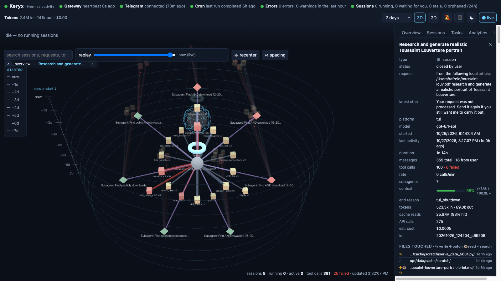

# Keryx

Keryx is a live visual activity monitor for [Hermes Agent](https://github.com/NousResearch/hermes-agent). It reads the agent's own records, its SQLite state, cron store and logs, without touching them, and turns them into a 3D force graph dashboard where shape, colour and position inform. Keryx runs as a small FastAPI container beside Hermes-Agent and serves a React front end on port 9120.

Named after κῆρυξ, the Greek herald who carried messages for Hermes.



- **Read-only.** Keryx opens Hermes' files, never writes them, and never talks to the agent.
- **Live.** A server-sent-events stream pushes an update whenever a Hermes file changes.
- **One rule for the picture.** Shape says *what* a thing is, colour says *how it is doing*, position says *when* it started.

## What you see

| Area | What it shows |
|---|---|
| Health header | gateway heartbeat, Telegram connection, cron scheduler, error log, session states. Green / amber / red per check; the worst one drives the title dot. |
| Right now | every open session: the user's request, the latest step, elapsed and idle time, calls per minute, context usage, subagents. |
| Graph | Hermes at the centre, the platforms it talks on around it, each session in its platform's wedge with its tools clustered around it, subagents in orbit, models on a shelf, cron jobs below. 3D or 2D. |
| Side panel | **overview** (health, recent file changes, tokens by model, legend), **sessions** (grouped by platform, live ones pinned), **tasks** (delegations board, scheduled jobs with run history and missed-trigger detection), **analytics** (daily trend, model share), **logs** (filterable tails). Selecting a node shows its details, context gauge, files touched and the turn-by-turn trace with tool arguments and results. |
| Notifications | in-app toasts, and desktop notifications if you allow them, when Hermes replies and waits for you, a session fails or is orphaned, a delegation finishes, a cron job fails or misses its trigger. |

**Compacted conversations.** When Hermes compacts a long chat it ends the session and continues in a child session. Keryx folds that lineage into one node: it starts when the first segment started, takes its colour from the latest segment, and its trace shows every segment with a ⟲ marker where the context was compacted. The node keeps the first segment's id, so a `#session:…` link to any segment opens the same node. Branches the user made (`/branch`) stay separate sessions, joined to their origin by a teal link; delegated subagents keep their purple link.

Session colours: **running**, **waiting for you** (open, last message is Hermes' reply: the next move is yours), **stale** (mid-turn and idle for 30 min), **ended**, **closed by user**, **orphaned** (killed by a gateway restart), **failed** (ended with tool errors). Tool failures come from the JSON result Hermes stores, not keyword matching.

## Requirements

- A Hermes Agent install whose data directory you can read. Keryx uses `state.db` (and its WAL), `cron/jobs.json`, `cron/executions.db`, `cron/ticker_heartbeat` and `logs/*.log` from that directory.
  - Native install: `~/.hermes` (Linux, macOS, WSL2).
  - Hermes in Docker: the host directory you mount at `/opt/data`.
- To run Keryx: Docker, **or** Python 3.11+.
- To build the front end: Node 18+ (the built files are not committed, so a fresh clone needs one build).

## Install

```bash
git clone https://github.com/rafreid/keryx.git
cd keryx/frontend && npm install && npm run build     # writes backend/static
cd ..
```

### Option A: Docker (recommended)

Hermes keeps its data directory mode 0700, so Keryx must run as the same user that owns it. For a native Hermes install that is you; for the official Hermes container it is the `HERMES_UID`/`HERMES_GID` you gave it (default 10000).

```bash
# native Hermes install, data in ~/.hermes
HERMES_UID=$(id -u) HERMES_GID=$(id -g) docker compose up -d --build

# Hermes in Docker with its data at /opt/hermes-data, owned by uid 10000
HERMES_HOME=/opt/hermes-data docker compose up -d --build
```

Then open http://localhost:9120/ (or the host's address from another machine).

If Hermes already runs from a compose file, you can instead paste the `keryx` service from [docker-compose.yml](docker-compose.yml) into it, set `build:` to the path of Keryx's `backend/` directory, and mount the same host directory you give Hermes.

### Option B: run it directly

```bash
cd backend
python3 -m venv .venv && .venv/bin/pip install -r requirements.txt
HERMES_DATA=~/.hermes .venv/bin/uvicorn app:app --host 0.0.0.0 --port 9120
```

### Check it works

`curl http://localhost:9120/api/health` should answer with `"state_db": true`. If it says `false`, `HERMES_DATA` does not point at a directory containing `state.db`, or the Keryx user cannot read it.

## Configuration

All settings are environment variables.

| Variable | Default | Meaning |
|---|---|---|
| `HERMES_DATA` | `/opt/data` | the Hermes data directory as seen by Keryx |
| `GRAPH_PORT` | `9120` | port to listen on (Docker image only) |
| `ACTIVE_WINDOW` | `300` | seconds; a session touched this recently is "active" and its links carry particles |
| `STALE_AFTER` | `1800` | seconds; a session that is mid-turn but idle for this long is shown as stale |
| `CONTEXT_LENGTH` | `400000` | assumed context window for the context gauge when the model name is not a recognised family (Hermes does not record the window size; such gauges are marked `~`) |

Colours and labels live in `frontend/src/util.js`; rebuild after changing them.

## Security

Keryx has **no authentication** and shows everything Hermes recorded, including prompts, replies and tool output. Keep it on a private network: bind the port to `127.0.0.1` and reach it over an SSH tunnel, or use a VPN such as Tailscale. Do not expose it to the internet. The only endpoint designed to be shared is `/api/diagnostics`, which is redacted (counts, states, ids, error lines with secrets masked; no message content).

## Using it

**Reading the graph.** Hover highlights a neighbourhood. Click a node to select it; sessions fan their tools out in a ring facing you. Click a platform to collapse it. Search dims everything that does not match. The legend in the overview tab has checkboxes to hide any kind or status.

**Time.** The window selector (last hour to all time) sets what is loaded. The replay bar re-queries the graph as of any moment in the window. The time axis on the left is clickable: each label keeps only the sessions that started in that span, and the stats bar reads "showing N of M".

**Spacing.** ⇔ spacing scales rings, link lengths and repulsion together (compact / normal / airy / wide, or a slider). ⌖ recenter frames the whole graph again. Both settings are remembered per browser.

**Navigation history.** Every selection (graph click, now-card, side-panel link, toast) is a browser history entry that remembers the selection, the side-panel tab and the camera pose just before the move. The trail under the toolbar shows `‹ back`, the last few stops (click one to jump there) and `› forward`. The URL hash (`#session:…`, `#cron:…`) is a deep link: share it, or scan it from the 📱 QR popover, and the page opens on that node.

**Keyboard.**

| Key | Action |
|---|---|
| `Backspace` | back to the previous selection and view |
| `Shift+Backspace` | forward |
| `Alt+←` / `Alt+→`, `⌘[` / `⌘]`, trackpad swipe | same, through the browser's own history |
| `⌘K` / `Ctrl+K` | focus search and open the sessions tab |
| `Esc` | clear the selection |

**Other buttons.** 🔔 enables desktop notifications. 📱 shows a QR code of the current page for your phone. ☾/☀ toggles the theme. ⤓ diagnostics (overview tab) downloads the redacted snapshot to attach to a bug report.

## Developing

```bash
cd frontend
npm install
KERYX_API=http://localhost:9120 npm run dev     # Vite dev server with /api proxied to a running backend
npm run build                                  # production build into backend/static
```

After a change, rebuild the front end and rebuild the container (`docker compose up -d --build`), or restart uvicorn if you run it directly.

Backend tests build a miniature Hermes data directory (state.db, cron store, logs) in a temp folder and run the real builders and routes against it:

```bash
cd backend
python3 -m venv .venv && .venv/bin/pip install -r requirements-dev.txt
.venv/bin/pytest
```

CI (GitHub Actions) runs the tests, builds the front end and smoke-tests the Docker image on every push and pull request.

Layout:

```
backend/   FastAPI app (app.py), Dockerfile, requirements.txt, static/ (built front end, not committed)
frontend/  Vite + React + react-force-graph source
```

## API

- `GET /api/graph?hours=24[&at=<epoch>]`  nodes/links; `at` replays the graph as of that moment
- `GET /api/now`  running + waiting sessions digest
- `GET /api/status`  health checks
- `GET /api/cost?hours=24`  tokens/cost per model
- `GET /api/tasks`  delegations (goals, children, duration, delivery), cron jobs (next run, history, missed, streak), scheduler heartbeat
- `GET /api/analytics?days=30`  daily trend, model share, totals
- `GET /api/session/{id}/trace?limit=300[&tool=name]`  ordered steps (user / assistant / tool call with args + result)
- `GET /api/logs?file=errors|gateway|agent|boot|restart|dashboard-auth&level=WARNING&q=text&lines=200`
- `GET /api/diagnostics`  redacted JSON snapshot for bug reports
- `GET /api/qr?text=`  SVG QR code
- `GET /api/stream?hours=24`  server-sent events, one `update` per data change
- `GET /api/health`  liveness

## Credits

Built on [3d-force-graph](https://github.com/vasturiano/3d-force-graph) through react-force-graph. Some ideas came from [AionUi](https://github.com/iOfficeAI/AionUi) (waiting-vs-running state and turn-completed notifications, context usage, task board, files touched, diagnostics export) and [Ekko Studio](https://github.com/EKKOLearnAI/ekko-studio) (usage analytics, tool-call traces, log viewer, themes).

Only the ideas were borrowed. No code, documentation or assets from either project is in Keryx: every feature was written from scratch against Hermes' own data, and a line-by-line and ten-word-shingle comparison of the Keryx sources against both repositories found nothing shared beyond generic boilerplate (Vite's HTML template head, React's import line, common CSS phrases). Keryx is MIT licensed and is not subject to either project's licence. For the record: AionUi is under the Apache License 2.0, and Ekko Studio is under the Business Source License 1.1 (non-commercial use only, converting to Apache 2.0 on 2029-05-10), which is why nothing from it may be copied into an MIT project.

## License

[MIT](LICENSE)
