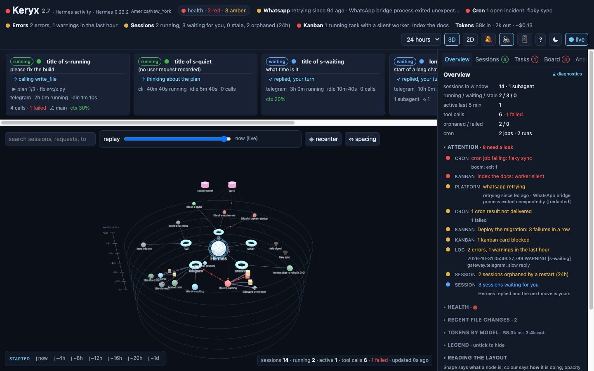
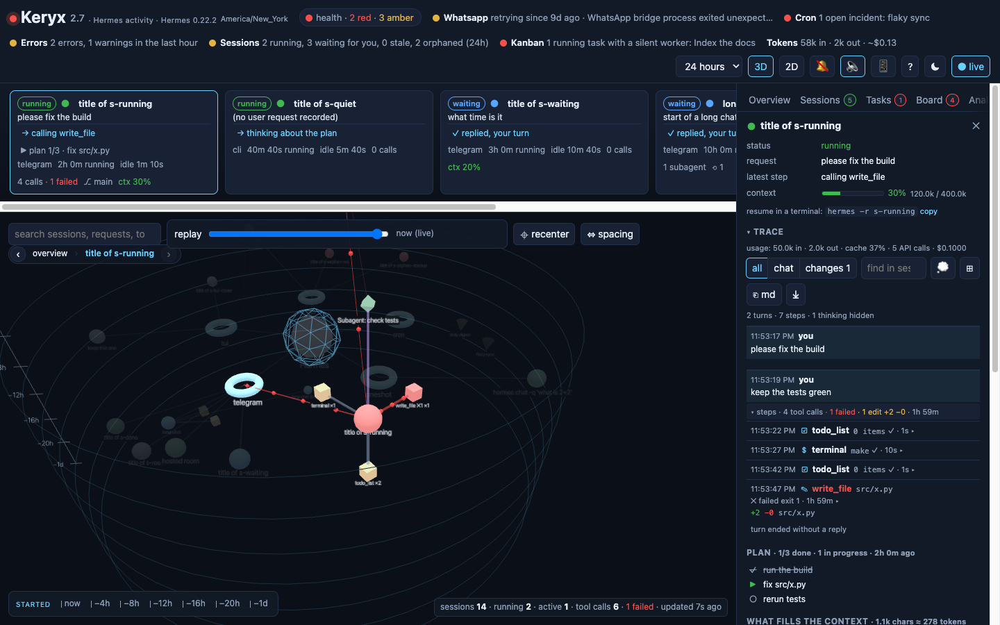
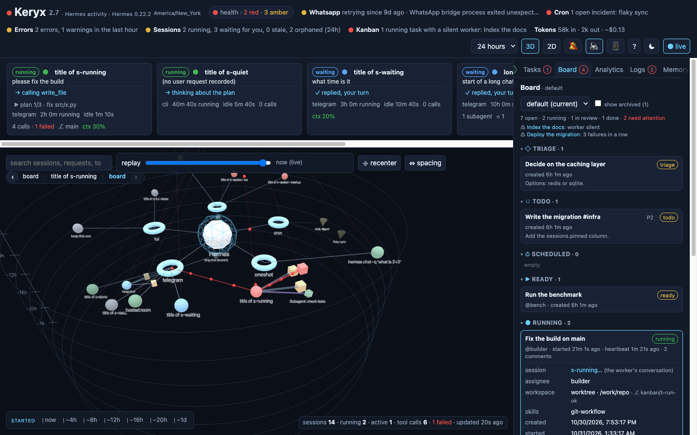
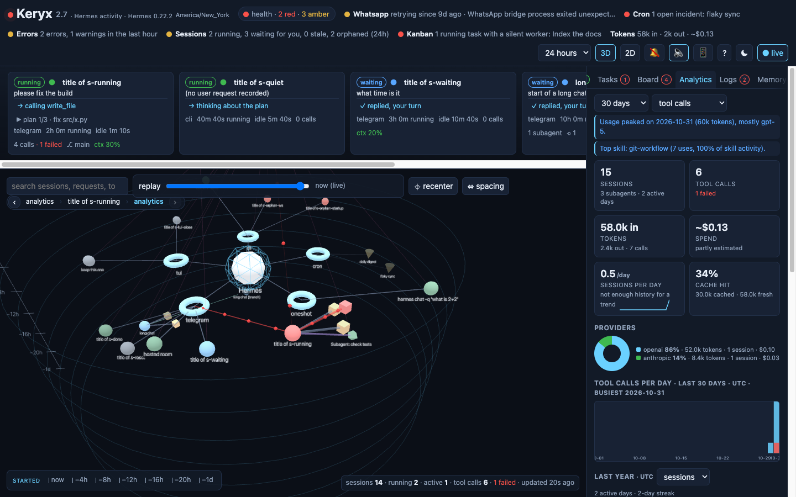
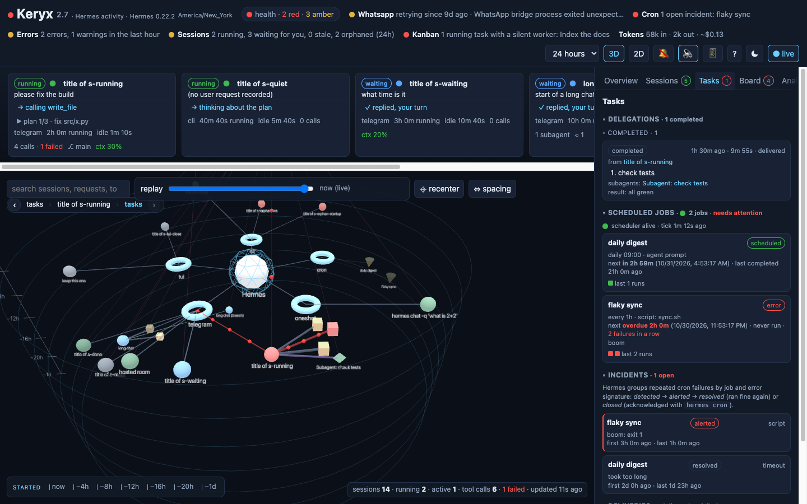
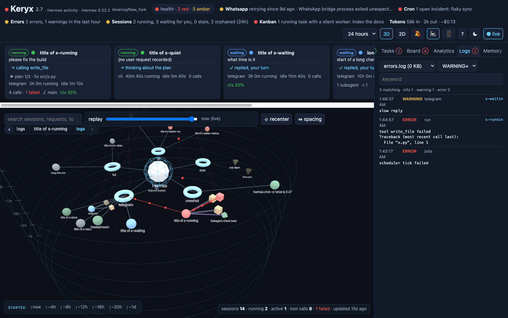
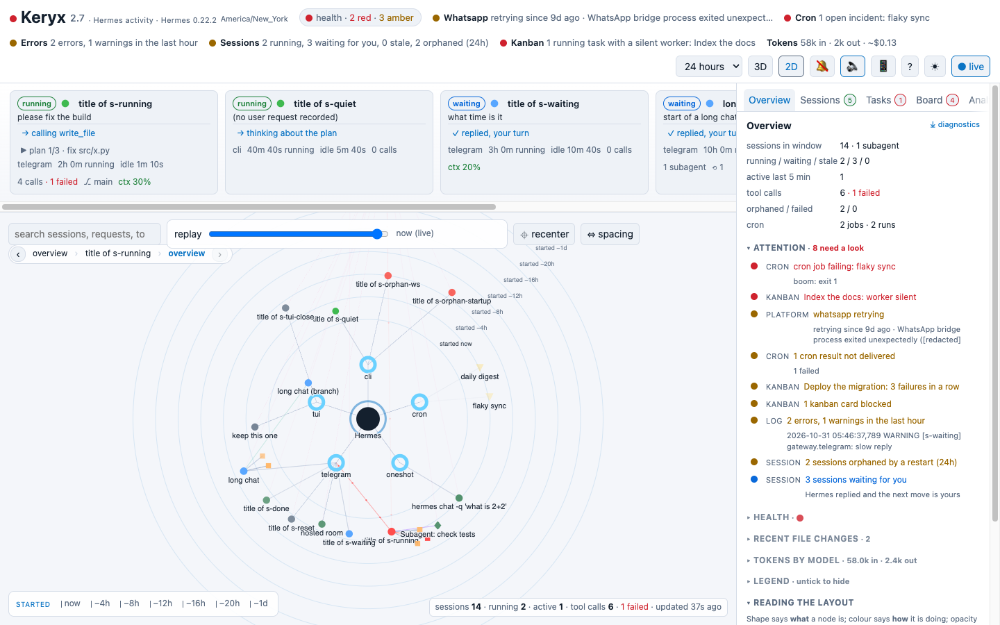
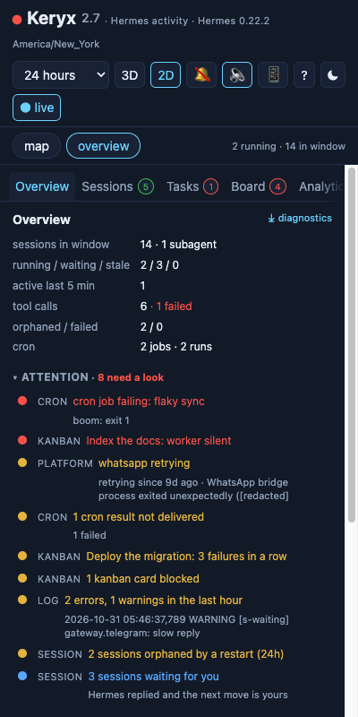
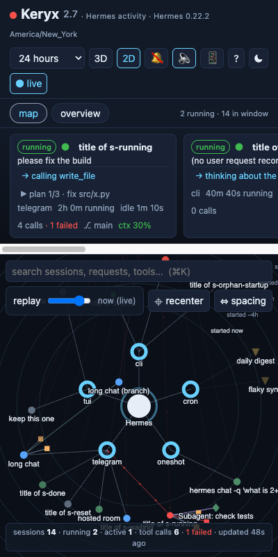

# Keryx

**A live visual activity monitor for [Hermes Agent](https://github.com/NousResearch/hermes-agent).**
Keryx reads the agent's own records (its SQLite state, cron store and logs) without touching them, and turns them into a 3D force-graph dashboard where shape, colour and position carry meaning. It runs as a small container beside Hermes and serves a web page on port 9120.

[](https://github.com/rafreid/keryx/actions/workflows/ci.yml)
[](https://github.com/rafreid/keryx/pkgs/container/keryx)
[](LICENSE)

Named after κῆρυξ, the Greek herald who carried messages for Hermes. Keryx is an open-source project of [Aflux Systems LLC](https://www.afluxsystems.com). Website: **https://rafreid.github.io/keryx/**



- **Read-only.** Keryx opens Hermes' files, never writes them, and never talks to the agent.
- **Live.** A server-sent-events stream pushes an update whenever a Hermes file changes; every panel refreshes on that one clock.
- **One rule for the picture.** Shape says *what* a thing is, colour says *how it is doing*, position says *when* it started.
- **Triage first.** One ranked attention list says what needs a look, and every line leads to the node or the tab that explains it.
- **Works on a phone, in both themes.** The graph and the panel take turns at full width; light and dark are both designed, not inverted.

## Screenshots

All screenshots are taken from the synthetic fixture the tests use, never from a real install.

| | |
|---|---|
|  |  |
| A selected session: status, request, latest step and context, then the trace as turns. | The kanban board, read-only, with a card open. |
|  |  |
| Analytics: insights, momentum, cache trend, provider mix, when Hermes works. | Tasks: delegations, scheduled jobs, incidents, the delivery queue. |
|  |  |
| Logs: every file Hermes writes, filtered by level; session-tagged lines link to their session. | The light theme, 2D view. |

<p align="center"> </p>

## Quick start

You need a Hermes Agent install whose data directory you can read, and either Docker or Python 3.11+. Node is **not** required: a prebuilt image is published for every release.

```bash
git clone https://github.com/rafreid/keryx.git
cd keryx
./quickstart.sh
```

Then open **http://localhost:9120/**.

The script finds your Hermes data directory (`~/.hermes` for a native install, `/opt/hermes-data` or `/opt/data` for the Docker install), works out which user owns it, pulls the Keryx image and starts it with Docker Compose. Without Docker it falls back to a Python virtualenv. Options:

| Command | What it does |
|---|---|
| `./quickstart.sh` | Docker if available, otherwise Python |
| `./quickstart.sh --build` | build the image from this checkout (needs Node 18+) |
| `./quickstart.sh --python` | skip Docker and run uvicorn directly |
| `HERMES_HOME=/srv/hermes ./quickstart.sh` | point at a non-standard data directory |

### Doing it by hand

**Docker.** Hermes keeps its data directory mode 0700, so Keryx must run as the user that owns it. For a native install that is you; for the official Hermes container it is the `HERMES_UID`/`HERMES_GID` you gave it (default 10000).

```bash
# native Hermes install, data in ~/.hermes
HERMES_HOME=~/.hermes HERMES_UID=$(id -u) HERMES_GID=$(id -g) docker compose up -d

# Hermes in Docker with its data at /opt/hermes-data, owned by uid 10000
HERMES_HOME=/opt/hermes-data docker compose up -d
```

If Hermes already runs from a compose file, paste the `keryx` service from [docker-compose.yml](docker-compose.yml) into it and mount the same host directory you give Hermes. The image is `ghcr.io/rafreid/keryx:latest`; add `HERMES_DASHBOARD_URL=http://<host>:9119` to get links into the Hermes dashboard.

**Python.**

```bash
cd frontend && npm install && npm run build && cd ..     # once; writes backend/static
cd backend
python3 -m venv .venv && .venv/bin/pip install -r requirements.txt
HERMES_DATA=~/.hermes .venv/bin/uvicorn app:app --host 0.0.0.0 --port 9120
```

### Check it works

`curl http://localhost:9120/api/health` should answer with `"state_db": true`. If it says `false`, `HERMES_DATA` does not point at a directory containing `state.db`, or the Keryx user cannot read it. See [Troubleshooting](#troubleshooting).

### Updating

```bash
git pull
docker compose pull keryx && docker compose up -d keryx      # Docker
# or, from source:  cd frontend && npm run build && cd .. && docker compose up -d --build keryx
```

## What you see

| Area | What it shows |
|---|---|
| Header | the title dot shows the worst health check; a **health** pill counts the red and amber ones and opens every check; only checks that are not green stay inline. Checks: gateway (heartbeat, Hermes' own process state and version from `gateway_state.json`, a pending restart), one per messaging platform as the gateway reports it, cron (incidents, missed slots, undelivered results), error log, sessions, the kanban board when it has tasks, storage. Token totals with the spend, `~` when estimated. The browser's timezone is named beside the title. |
| Right now | one card per open session: the request, the latest step, plan progress, elapsed and idle time, calls per minute, context usage, git branch, subagents. |
| Attention | one ranked list of everything red or amber (failing cron jobs, platforms that are not connected, silent kanban workers, undelivered results, log errors, a pending gateway restart, orphaned sessions) and, last, the sessions waiting for you. Each line selects the node or opens the tab. |
| Graph | Hermes at the centre, the platforms it talks on around it, each session in its platform's wedge with its tools clustered around it, subagents in orbit, models on a shelf, cron jobs below. 3D or 2D; labels scale with distance. A clickable ruler along the bottom filters by when a session started. |
| Selected node | a session opens with four lines (status, request, latest step, context gauge) and the command to resume it in a terminal, then the **trace** as a reading view, the agent's **plan** (its `todo_list`), **what fills the context** (your messages, replies, tool-call arguments and tool output by tool, in characters), **files touched**, and two collapsed sections: cost and usage, lineage and environment. |
| Sessions tab | grouped by platform, time or project; `#tags` from titles as filter chips; ☆ pins, ★ for sessions pinned in Hermes itself; Hermes' internal sessions (one-shot calls, tool helpers, kanban workers) in a collapsed group; sessions Hermes hides stay out unless you tick "show hidden". The search box also looks inside conversations through Hermes' full-text index. |
| Tasks tab | delegations board, scheduled jobs with run history and missed slots, Hermes' cron incidents and delivery queue. |
| Board tab | Hermes' kanban queue in its own lanes, read-only: cards with assignee, priority, heartbeat and failure streak; click one for its body, result, worker session, comments, runs and event timeline; a board switcher when there are several. |
| Analytics tab | insight sentences, sessions-per-day momentum, cache-hit trend, provider mix, when Hermes works by hour of day and weekday, daily trend, a year heatmap, per-day cost, model share, Hermes' skill ledger, achievement unlocks. |
| Logs tab | filterable tails of every log file Hermes writes; lines logged inside a session link to it. |
| Memory tab | Hermes' `MEMORY.md` and `USER.md`, read-only, opt-in (`KERYX_SHOW_MEMORY=1`). |
| Phone | under 800px the graph and the panel take turns at full width behind a map / panel toggle; screens under 1200px start in 2D. |
| First run | a card explains shape, colour and position, the glyphs, and where the data comes from; the `?` in the header brings it back. |
| Notifications | in-app toasts, desktop notifications if you allow them, and optional short synthesised sounds (no audio files), when Hermes replies and waits for you, a session fails or is orphaned, a delegation finishes, a cron job fails or misses its trigger. |

**Compacted conversations.** When Hermes compacts a long chat it ends the session and continues in a child session. Keryx folds that lineage into one node: it starts when the first segment started, takes its colour from the latest segment, and its trace shows every segment with a ⟲ marker where the context was compacted. The node keeps the first segment's id, so a `#session:…` link to any segment opens the same node. Branches the user made (`/branch`) stay separate sessions joined to their origin by a teal link; delegated subagents keep their purple link.

**Reading a session.** The trace is shown as turns: your question, a collapsible **steps · N** block (every tool call with a kind glyph, a one-line title such as the command or path, duration, exit code, and `+added −removed` for file edits; Hermes' own events; intermediate notes), then Hermes' reply. An **outline** lists every question with its step count, failures and edits and jumps to it. **all / chat / changes** shows the whole thing, the conversation alone, or only the file edits. **find in session** dims everything that does not match. **💭** shows the model's reasoning where the provider returned it (hidden by default, head of each one, searchable and exported while shown). **⎘ md** copies the session as Markdown and **⤓** downloads it. Busy turns start collapsed; failed or running ones start open.

**Session colours:** **running**, **waiting for you** (open, last message is Hermes' reply: the next move is yours), **stale** (mid-turn and idle for 30 min), **ended**, **closed by user**, **orphaned** (killed by a gateway restart), **failed** (ended with tool errors). Tool failures come from the JSON result Hermes stores, not keyword matching.

## Using it

**Reading the graph.** Hover highlights a neighbourhood. Click a node to select it; sessions fan their tools out in a ring facing you. Click a platform to collapse it. Search dims everything that does not match. The legend in the overview tab has checkboxes to hide any kind or status.

**Time.** The window selector (last hour to all time) sets what is loaded. The replay bar re-queries the graph as of any moment in the window. The ruler along the bottom of the graph is clickable: each label keeps only the sessions that started in that span, and the stats bar reads "showing N of M". Times are shown in your browser's zone (named in the header); analytics days are counted in UTC.

**Spacing.** ⇔ spacing scales rings, link lengths and repulsion together (compact / normal / airy / wide, or a slider). ⌖ recenter frames the whole graph again. Both settings are remembered per browser.

**Navigation history.** Every selection (graph click, now-card, side-panel link, toast) is a browser history entry that remembers the selection, the side-panel tab and the camera pose just before the move. The trail under the toolbar shows `‹ back`, the last few stops (click one to jump there) and `› forward`. The URL hash (`#session:…`, `#cron:…`) is a deep link: share it, or scan it from the 📱 QR popover, and the page opens on that node.

**Keyboard.**

| Key | Action |
|---|---|
| `Backspace` | back to the previous selection and view |
| `Shift+Backspace` | forward |
| `Alt+←` / `Alt+→`, `⌘[` / `⌘]`, trackpad swipe | same, through the browser's own history |
| `⌘K` / `Ctrl+K` | focus search and open the sessions tab |
| `[` / `]` | previous / next side-panel tab |
| `↑` / `↓`, `Enter` | walk the session list, select the focused row |
| `Esc` | clear the selection |

Every icon button carries a label for screen readers and a visible focus ring.

**Other buttons.** 🔔 enables desktop notifications; 🔈 adds a short sound per notification (synthesised in the browser, off by default). 📱 shows a QR code of the current page for your phone; Keryx ships a web-app manifest, so "add to home screen" keeps it as an app there. `?` reopens the first-run card. ☾/☀ toggles the theme. ⤓ diagnostics (overview tab) downloads a redacted snapshot to attach to a bug report.

## Configuration

All settings are environment variables.

| Variable | Default | Meaning |
|---|---|---|
| `HERMES_DATA` | `/opt/data` | the Hermes data directory as seen by Keryx (inside the container this is the mount; use `HERMES_HOME` on the host side of `docker compose`) |
| `GRAPH_PORT` | `9120` | port to listen on (Docker image only) |
| `HERMES_DASHBOARD_URL` | unset | where the Hermes dashboard (`hermes dashboard`, port 9119) is reachable from your browser, e.g. `http://192.168.1.100:9119`; adds "open in the Hermes dashboard" links on sessions, cron jobs and logs. Keryx never calls it |
| `KERYX_TOKEN` | unset | optional shared secret; when set, every `/api` route except `/api/health` requires it (see Security) |
| `KERYX_SHOW_MEMORY` | unset | `1` adds a read-only **memory** tab showing Hermes' `memories/MEMORY.md` and `USER.md` entries with their character budgets. These are personal notes about you and your environment, so the tab is off until you ask for it; the diagnostics download never includes them |
| `ACTIVE_WINDOW` | `300` | seconds; a session touched this recently is "active" and its links carry particles |
| `STALE_AFTER` | `1800` | seconds; a session that is mid-turn but idle for this long is shown as stale |
| `CONTEXT_LENGTH` | `400000` | last-resort context window for the gauge. Keryx first uses `model.context_length` from Hermes' config.yaml, then the window Hermes probed and cached in `context_length_cache.yaml`, then a small built-in table; only a model none of those know falls back to this value, and the gauge says so |

Colours and labels live in `frontend/src/util.js`; rebuild after changing them.

## What Keryx reads

Everything comes from the Hermes data directory, read-only: `state.db` (and its WAL, including Hermes' full-text index `messages_fts` when present), `gateway_state.json` (the gateway's own process and per-platform state), `context_length_cache.yaml` and the `model:` section of `config.yaml` (context windows), `kanban.db` and `kanban/boards/*/kanban.db` (the task queue), `plugin-data/hermes-achievements/state.json` (achievement unlocks), `cron/jobs.json`, `cron/executions.db`, `cron/incidents.db`, `cron/deliveries.db`, `cron/ticker_heartbeat`, `logs/*.log`, `skills/.usage.json` (the skill ledger) and, only with `KERYX_SHOW_MEMORY=1`, `memories/MEMORY.md`, `memories/USER.md` and the `memory:` section of `config.yaml`. Files that an older Hermes does not write are skipped, and columns are feature-detected, so Keryx works across Hermes versions. The volume is mounted read-write only because SQLite in WAL mode must be able to create its `-shm` file; Keryx itself never writes.

## Security

Keryx shows everything Hermes recorded, including prompts, replies and tool output. Keep it on a private network: bind the port to `127.0.0.1` and reach it over an SSH tunnel, or use a VPN such as Tailscale. Do not expose it to the internet.

Setting `KERYX_TOKEN` adds a shared secret on top of that: every `/api` route then needs `Authorization: Bearer <token>`, a `keryx_token` cookie, or `?token=`. The page asks for the token once and keeps it as a cookie; `curl` and scripts send the header. `/api/health` stays open for liveness probes but omits the data path without the token. This is a lock on the door, not a user system: there is one token, and anyone with it sees everything.

The only endpoint designed to be shared is `/api/diagnostics`, which is redacted (counts, states, ids, error lines with secrets masked; no message content).

## Troubleshooting

| Symptom | Cause and fix |
|---|---|
| `"state_db": false` from `/api/health` | the data path is wrong, or unreadable. Native install: `HERMES_HOME=~/.hermes`. Docker Hermes: the host directory you mount at `/opt/data`. Check `ls -la` on it: Keryx must run as its owner (`HERMES_UID`/`HERMES_GID`). |
| `permission denied` in `docker compose logs keryx` | the uid/gid do not match the directory owner. `stat -c '%u:%g' ~/.hermes` (Linux) or `stat -f '%u:%g' ~/.hermes` (macOS) tells you the right pair. |
| `frontend not built` (HTTP 503 on `/`) | you ran from source without building: `cd frontend && npm install && npm run build`, or use the published image. |
| The graph is empty | widen the window (top right); the default is the last 24 hours. |
| Health says `no heartbeat` | Hermes' gateway is not running, or it is an old Hermes without the `gateway_heartbeats` table. |
| Context gauge says "assumed window" | neither Hermes' config nor its probe cache knows this model's window; set `model.context_length` in Hermes' config.yaml or `CONTEXT_LENGTH` for Keryx. |
| The page asks for a token | `KERYX_TOKEN` is set on the server; paste it once. |
| Sessions tab says `slow search (no FTS index)` | your Hermes predates the `messages_fts` index; Keryx falls back to a `LIKE` scan, which works but is slower on a big `state.db`. |
| Memory tab says the panel is off | expected: set `KERYX_SHOW_MEMORY=1` to show Hermes' memory files. |
| Health shows `storage` amber with a large WAL | Hermes' SQLite checkpoints are not landing (usually a reader holding the database open for a long time); restart Hermes' gateway and the WAL folds back into `state.db`. |

Attach `/api/diagnostics` (the ⤓ link in the overview tab) to a bug report; it contains no message content.

## Developing

```bash
cd frontend
npm install
KERYX_API=http://localhost:9120 npm run dev     # Vite dev server with /api proxied to a running backend
npm run build                                  # production build into backend/static
npm test                                       # vitest: layout, turns, grouping, notification, sound and plural logic
```

Backend tests build a miniature Hermes data directory (state.db, cron store, logs) in a temp folder and run the real builders and routes against it:

```bash
cd backend
python3 -m venv .venv && .venv/bin/pip install -r requirements-dev.txt
.venv/bin/pytest
```

CI runs both test suites, builds the front end and smoke-tests the Docker image on every push and pull request. Pushes to `main` and `v*` tags publish `ghcr.io/rafreid/keryx` for amd64 and arm64.

Layout:

```
backend/   FastAPI app (app.py), Dockerfile, requirements.txt, tests/, static/ (built front end, not committed)
frontend/  Vite + React + react-force-graph source; src/hooks/ holds the camera, time-axis, media-query and refresh-tick hooks
docs/      the project website (GitHub Pages) and screenshots
```

After a change, rebuild the front end and rebuild the container (`docker compose up -d --build keryx`), or restart uvicorn if you run it directly.

## API

- `GET /api/graph?hours=24[&at=<epoch>]`  nodes/links; `at` replays the graph as of that moment; `aliases` maps compacted segment ids to their node
- `GET /api/now`  running + waiting sessions digest
- `GET /api/status`  health checks (platform checks carry `kind: "platform"`), the ranked `attention` list (`severity`, `source`, `label`, `detail`, `node` or `tab`), dashboard links, and `hermes` (gateway state, desired state, version, pid, served profiles, restart requested) from `gateway_state.json`, or `null` without it
- `GET /api/cost?hours=24`  tokens/cost per model; `cost_basis` says whether the money is provider-reported (`actual`), priced from a table (`estimated`), `included` in a subscription or `unknown`
- `GET /api/tasks`  delegations (goals, children, duration, delivery), cron jobs (next run, history, missed slots, open incidents), scheduler heartbeat, incidents, delivery queue, kanban counts
- `GET /api/kanban?board=<slug>&archived=0`  the kanban board as lanes in Hermes' workflow order, every task with links, comment count, latest run and a `stale` flag for silent workers; `boards` lists the others
- `GET /api/kanban/{task_id}?board=<slug>`  one card in full: comments, run history, event timeline, attachment count
- `GET /api/analytics?days=30`  daily trend with per-day cost, a 53-week `heatmap`, model share, Hermes' skill ledger (`skills`), totals, `providers` (token share per billing provider), `clock` (hour of day and weekday × hour), `velocity`, `insights`, `achievements`
- `GET /api/search?q=text&limit=30`  sessions whose conversation mentions the text (Hermes' FTS5 index, `LIKE` fallback), with snippets; segments of a compacted conversation fold into one hit
- `GET /api/memory`  `MEMORY.md` / `USER.md` entries with character budgets; `enabled: false` unless `KERYX_SHOW_MEMORY=1`
- `GET /api/session/{id}/trace?limit=300[&tool=name]`  ordered steps (user / assistant / tool call with args + result / event / compaction), across every segment of a compacted conversation; tool calls carry `tool_kind`, `title`, `diff` (`added`/`removed` lines for `write_file` and `patch`), `exit_code`, `lines`; `thinking` steps carry the head of the model's reasoning when the provider returned it
- `GET /api/session/{id}/todo`  the agent's current plan: the newest `todo_list` result in the conversation
- `GET /api/session/{id}/context`  what fills the context of the conversation's current segment: characters by part (your messages, replies, tool-call arguments, tool output, compaction summaries) and by tool, the largest output, and the gauge
- `GET /api/logs?file=<stem of any logs/*.log>&level=WARNING&q=text&lines=200`  entries carry the session id when Hermes logged the line inside a session
- `GET /api/diagnostics`  redacted JSON snapshot for bug reports
- `GET /api/qr?text=`  SVG QR code
- `GET /api/stream?hours=24`  server-sent events, one `update` per data change; one watcher serves every connected client
- `GET /api/health`  liveness

## Credits

Built on [3d-force-graph](https://github.com/vasturiano/3d-force-graph) through react-force-graph. Some ideas came from [AionUi](https://github.com/iOfficeAI/AionUi) (waiting-vs-running state and turn-completed notifications, context usage, task board, files touched, diagnostics export) and [Ekko Studio](https://github.com/EKKOLearnAI/ekko-studio) (usage analytics, tool-call traces, log viewer, themes).

Only the ideas were borrowed. No code, documentation or assets from either project is in Keryx: every feature was written from scratch against Hermes' own data, and a line-by-line and ten-word-shingle comparison of the Keryx sources against both repositories found nothing shared beyond generic boilerplate (Vite's HTML template head, React's import line, common CSS phrases). Keryx is MIT licensed and is not subject to either project's licence. For the record: AionUi is under the Apache License 2.0, and Ekko Studio is under the Business Source License 1.1 (non-commercial use only, converting to Apache 2.0 on 2029-05-10), which is why nothing from it may be copied into an MIT project.

## About

Keryx is an open-source project of [Aflux Systems LLC](https://www.afluxsystems.com), released under the [MIT license](LICENSE). Issues and pull requests are welcome at [github.com/rafreid/keryx](https://github.com/rafreid/keryx).
